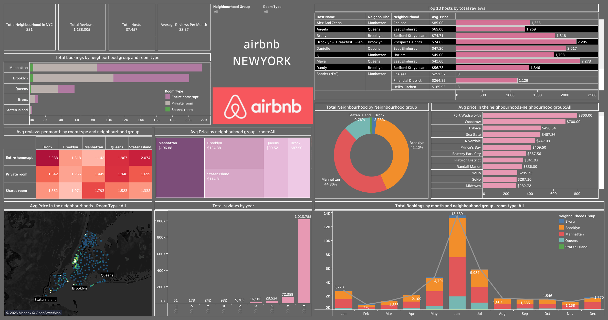

# NYC Airbnb 2019 | Tableau Analytics Dashboard

## Project Overview

An interactive Tableau dashboard exploring New York City's Airbnb listing market in 2019.

Developed as part of an academic project, this dashboard provides insights into listing distribution, pricing patterns, room types, host activity, and customer review trends across NYC neighborhoods.

## Project Objectives

- Analyze Airbnb listing distribution across NYC boroughs and neighborhoods.
- Explore pricing differences by location and room type.
- Identify host activity and listing concentration.
- Examine customer review patterns.
- Present insights through interactive Tableau visualizations.

  ## Dashboard Preview

## Dashboard Features

**Listing & Pricing Analysis**
- Airbnb listing distribution
- Average pricing across neighborhoods
- Room-type comparisons

**Host & Review Analysis**
- Host activity and rankings
- Review trends
- Neighborhood-level comparisons

**Interactive Visualizations**
- KPI summaries
- Comparative charts
- Geographic and categorical analysis

## Tools & Technologies

- Tableau Public
- Microsoft Excel
- Data Visualization
- Exploratory Data Analysis
- Business Intelligence

## Dataset

**Source:** NYC Airbnb Open Data (2019)

The dataset includes Airbnb listing information, neighborhood details, room types, pricing, availability, and reviews.

## Project Context

Developed as part of an academic Tableau project with faculty guidance.

## Author

**Akshata P. Pai**

[LinkedIn](https://www.linkedin.com/in/akshata-p-pai) | [GitHub](https://github.com/akspai2904) | [Tableau Public](https://public.tableau.com/app/profile/akshata.pai)
